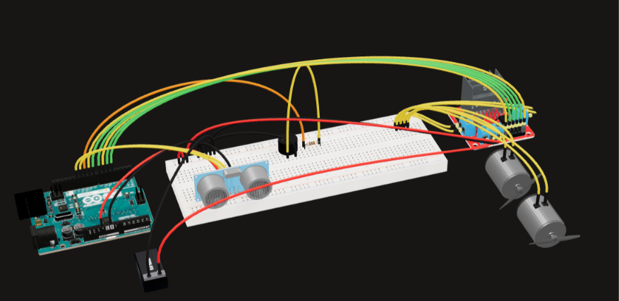
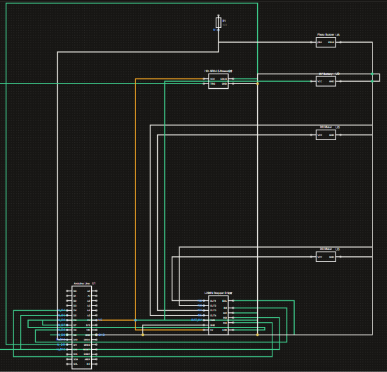

# 📚 Actividad A2.4: Control de Motores y Alerta Sonora por Proximidad mediante Sensor Ultrasónico

> Implementación de un sistema de detección de distancia y evitación de obstáculos con señalización acústica adaptativa y control PWM de motores utilizando Arduino Uno, un sensor HC-SR04 y un puente H L293D.

---

## 1) Resumen

- **Materia:** Proyecto de Introducción a la Ingeniería
- **Profesor:** Dr. Antonio Martínez Torteya
- **Equipo:** 
  - Juan Carlos Valdés Pérez
  - Antonio Isidoro Ureña Chaidez 
  - Marcelo Cantú Palacios
  - Sofía Posas
- **Fecha:** 12/10/2026
- **Placa:** Arduino Uno R3 (Elegoo)
- **Descripción breve:** Sistema robótico mecatrónico que integra un sensor de ultrasonido HC-SR04, un buzzer pasivo y un driver L293D para regular la velocidad de dos tracciones (4 motores en pares) y emitir alertas sonoras de frecuencia variable en función de la proximidad a un obstáculo.

---

## 2) Introducción

En los sistemas robóticos móviles e industriales autónomos, la percepción del entorno inmediato resulta fundamental para garantizar la navegación segura y prevenir colisiones. El sensado de distancia mediante ondas ultrasónicas constituye una de las técnicas más extendidas debido a su excelente relación costo-beneficio, inmunidad relativa a las condiciones de iluminación ambiental y capacidad para medir distancias en tiempo real sin contacto físico.

El objetivo de esta práctica es diseñar, implementar y validar un circuito mecatrónico capaz de ajustar de forma dinámica el comportamiento de tracción de un chasis de cuatro motores (agrupados en dos pares mediante un driver L293D) y generar señales de advertencia sonora a través de un buzzer pasivo. Conforme un objeto reduce su distancia respecto al sensor HC-SR04, el sistema disminuye progresivamente la velocidad de avance de los motores y retrocede ante proximidades críticas, incrementando simultáneamente la frecuencia de tono e intermitencia del buzzer para alertar sobre una colisión inminente.

---

## 3) Metodología

### 3.1 Conexiones

**Componentes utilizados y justificación técnica:**

- **Sensor Ultrasónico HC-SR04:** Utilizado como transductor principal de distancia. Funciona mediante la emisión de un pulso de ultrasonido de 40 kHz a través del transmisor (*Trigger*) y la medición del tiempo de vuelo ($t$) del eco reflejado en el receptor (*Echo*). Conociendo la velocidad del sonido en el aire a temperatura ambiente ($v \approx 343\text{ m/s} = 0.0343\text{ cm/\mu s}$), la distancia ($d$) se calcula como:
  $$d = \frac{v \cdot t}{2} = \frac{0.0343\text{ cm/\mu s} \cdot t\ (\mu\text{s})}{2}$$
  La división entre dos contempla el trayecto de ida y vuelta de la onda acústica.
- **Circuit Integrado L293D (Puente H Quadruple Half-H Driver):** Permite el control bidireccional y la regulación de velocidad por modulación por ancho de pulso (PWM) de dos pares de motores DC. El chip aísla eléctricamente la lógica de control del Arduino respecto al consumo inductivo de los motores.
- **4 Motores DC (Configurados en 2 pares de tracción):** 
  - *Par Izquierdo ($M1 + M2$):* Conectados en paralelo a las salidas `OUT1` y `OUT2` del L293D.
  - *Par Derecho ($M3 + M4$):* Conectados en paralelo a las salidas `OUT3` y `OUT4` del L293D.
- **1 Buzzer Pasivo:** Indicador acústico de alerta. Requiere una señal de frecuencia modulada (proporcionada mediante la función `tone()` del microcontrolador) para hacer oscilar su diafragma piezoeléctrico y emitir tonos diferenciados.
- **Protoboard y Cableado Jumper:** Para el interconectado ordenado del circuito integrado, sensor y periféricos.

**Descripción de las conexiones físicas:**

- **Sensor Ultrasónico HC-SR04:**
  - `VCC` a la línea de **5V** del Arduino.
  - `GND` al riel común de tierra (**GND**).
  - `TRIG` al **Pin Digital 12** (Salida digital).
  - `ECHO` al **Pin Digital 11** (Entrada digital).
- **Driver de Motores L293D:**
  - `VCC1` (Pin 16 - Lógica) a la línea de **5V** del Arduino.
  - `VCC2` (Pin 8 - Potencia) a la línea de **5V** del Arduino.
  - `GND` (Pines 4, 5, 12, 13) conectados en común al **GND** de la placa.
  - `ENA` (Pin 1 - PWM Canal A) al **Pin Digital 9** (Soporta PWM).
  - `IN1` e `IN2` (Pines 2 y 7) a los **Pines Digitales 8 y 7** respectivamente.
  - `ENB` (Pin 9 - PWM Canal B) al **Pin Digital 3** (Soporta PWM).
  - `IN3` e `IN4` (Pines 10 y 15) a los **Pines Digitales 5 y 4** respectivamente.
  - `OUT1` y `OUT2` (Pines 3 y 6) alimentan el **Par de Motores Izquierdo**.
  - `OUT3` y `OUT4` (Pines 11 y 14) alimentan el **Par de Motores Derecho**.
- **Buzzer Pasivo:**
  - Terminal positiva al **Pin Digital 2** del Arduino.
  - Terminal negativa conectada a tierra (**GND**).

**Diagrama de conexiones:**



*(Nota: El archivo de imagen y diagrama esquemático editable se encuentra adjunto en la carpeta `/Recursos/imgs/` del repositorio).*

---

### 3.2 Código

El sketch de Arduino está organizado modularmente en funciones de medición de tiempo de vuelo, control de estados de tracción del puente H mediante señales PWM y un temporizador no bloqueante para el generador de tono del buzzer pasivo.

**Declaración de variables y prototipos:**
Se asignan constantes de tipo `uint8_t` para los pines del sensor (`TRIG_PIN = 12`, `ECHO_PIN = 11`), del buzzer (`BUZZER_PIN = 2`) y de las señales de entrada/habilitación del driver L293D (`ENA = 9`, `IN1 = 8`, `IN2 = 7`, `ENB = 3`, `IN3 = 5`, `IN4 = 4`). Se inicializa la variable `lastBeepMs` para gestionar los intervalos de alerta auditiva sin detener la ejecución global.

**Configuración (`setup()`):**
Se definen los modos de operación de los pines con `pinMode()`: el pin `TRIG_PIN` y las líneas del L293D/Buzzer se configuran como salidas (`OUTPUT`), mientras que `ECHO_PIN` se establece como entrada (`INPUT`). Finalmente, se invoca `stopMotors()` para garantizar un estado seguro en reposo al energizar el microcontrolador.

**Ciclo Principal (`loop()`):**
Mide constantemente la distancia invoking a `measureDistanceCm()` y aplica la siguiente máquina de decisiones:
1. **Error / Fuera de rango ($cm \le 0$):** Inicia un avance cauteloso (`forward(120)`) y desactiva el sonido con `noTone()`.
2. **Zona Crítica / Peligro ($cm \le 20.0\text{ cm}$):** Detiene la marcha inmediatamente, genera una alarma rápida en el buzzer (1800 Hz cada 120 ms) y realiza una maniobra evasiva en reversa (`backward(170)`) antes de hacer una breve pausa de seguridad.
3. **Zona de Advertencia ($20.0\text{ cm} < cm \le 40.0\text{ cm}$):** Reduce la velocidad de avance a $140/255$ e inicia una señal sonora de aviso con menor frecuencia e intermitencia (1200 Hz cada 350 ms).
4. **Zona Mínimo Riesgo / Despejado ($cm > 40.0\text{ cm}$):** Incrementa la tracción a velocidad crucero de $200/255$ y apaga la alerta sonora.

**Funciones Auxiliares:**
- `measureDistanceCm()`: Genera un pulso TTL de 10 $\mu$s en el pin `TRIG_PIN` y mide con `pulseIn()` el tiempo de nivel alto en `ECHO_PIN` (con un *timeout* de 25 ms, equivalente a $4\text{ m}$). Calcula y retorna la distancia en centímetros.
- `forward(speedPwm)` y `backward(speedPwm)`: Establecen el sentido de rotación polarizando las entradas de control `IN1-IN4` del L293D y envían el ciclo de trabajo mediante `analogWrite()` a las entradas `ENA` y `ENB`.
- `stopMotors()`: Aplica un freno pasivo enviando valor `0` de PWM a las habilitaciones y nivel lógico bajo a las cuatro entradas de control.
- `beepEvery(intervalMs, freqHz)`: Compara el tiempo actual mediante `millis()` contra `lastBeepMs`. Si transcurrió el intervalo programado, emite una ráfaga sonora de 70 ms con la frecuencia dada mediante la función `tone()`.

**Código:**

```cpp
// Fusion: HC-SR04 + buzzer + control de 2 motores con puente H
// Arduino Uno
//
// Motor izquierdo  (M1) -> OUT1/OUT2
// Motor derecho    (M2) -> OUT3/OUT4

const uint8_t TRIG_PIN = 12;
const uint8_t ECHO_PIN = 11;
const uint8_t BUZZER_PIN = 10;

// L293D
const uint8_t ENA = 9;  // PWM canal A
const uint8_t IN1 = 8;
const uint8_t IN2 = 7;
const uint8_t ENB = 6;  // PWM canal B (evita conflicto con tone() en Timer2)
const uint8_t IN3 = 5;
const uint8_t IN4 = 4;

unsigned long lastBeepMs = 0;

float measureDistanceCm();
void forward(uint8_t speedPwm);
void backward(uint8_t speedPwm);
void stopMotors();
void beepEvery(unsigned long intervalMs, unsigned int freqHz);

void setup() {
  pinMode(TRIG_PIN, OUTPUT);
  pinMode(ECHO_PIN, INPUT);
  pinMode(BUZZER_PIN, OUTPUT);

  pinMode(ENA, OUTPUT);
  pinMode(ENB, OUTPUT);
  pinMode(IN1, OUTPUT);
  pinMode(IN2, OUTPUT);
  pinMode(IN3, OUTPUT);
  pinMode(IN4, OUTPUT);

  stopMotors();
}

void loop() {
  const float cm = measureDistanceCm();

  // Si no hay lectura válida, avance suave por seguridad.
  if (cm <= 0) {
    forward(120);
    noTone(BUZZER_PIN);
    delay(80);
    return;
  }

  if (cm <= 15.0) {
    // Muy cerca: alerta rápida y retroceso breve
    stopMotors();
    beepEvery(120, 1800);
    delay(100);

    backward(170);
    delay(250);
    stopMotors();
    delay(80);
  } else if (cm <= 40.0) {
    // Distancia media: avance lento + beep intermitente
    forward(140);
    beepEvery(350, 1200);
    delay(80);
  } else {
    // Lejos: avance normal sin alarma
    forward(200);
    noTone(BUZZER_PIN);
    delay(80);
  }
}

float measureDistanceCm() {
  digitalWrite(TRIG_PIN, LOW);
  delayMicroseconds(2);
  digitalWrite(TRIG_PIN, HIGH);
  delayMicroseconds(10);
  digitalWrite(TRIG_PIN, LOW);

  // Timeout ~25 ms (aprox 4 m)
  const unsigned long duration = pulseIn(ECHO_PIN, HIGH, 25000UL);
  if (duration == 0) {
    return -1.0;
  }

  return (duration * 0.0343f) / 2.0f;
}

void forward(uint8_t speedPwm) {
  analogWrite(ENA, speedPwm);
  analogWrite(ENB, speedPwm);

  digitalWrite(IN1, HIGH);
  digitalWrite(IN2, LOW);
  digitalWrite(IN3, HIGH);
  digitalWrite(IN4, LOW);
}

void backward(uint8_t speedPwm) {
  analogWrite(ENA, speedPwm);
  analogWrite(ENB, speedPwm);

  digitalWrite(IN1, LOW);
  digitalWrite(IN2, HIGH);
  digitalWrite(IN3, LOW);
  digitalWrite(IN4, HIGH);
}

void stopMotors() {
  analogWrite(ENA, 0);
  analogWrite(ENB, 0);

  digitalWrite(IN1, LOW);
  digitalWrite(IN2, LOW);
  digitalWrite(IN3, LOW);
  digitalWrite(IN4, LOW);
}

void beepEvery(unsigned long intervalMs, unsigned int freqHz) {
  const unsigned long now = millis();

  if (now - lastBeepMs >= intervalMs) {
    tone(BUZZER_PIN, freqHz, 70);
    lastBeepMs = now;
  }
}
```
--- 

## 4) Resultados

A continuación se presentan las evidencias de funcionamiento del sistema tanto en simulación digital:

### 4.1 Demostración en Simulación (Digital)
<p align="center">
  
</p>

---

### Validación de Comportamiento

- **Zona Despejada ($> 40\text{ cm}$):** Los motores mantuvieron un avance continuo a una velocidad equivalente al 78% del ciclo de trabajo (PWM = 200), y el buzzer pasivo permaneció completamente en silencio[cite: 1].
- **Zona de Advertencia ($20\text{ cm} \text{ a } 40\text{ cm}$):** Al aproximar un obstáculo, la velocidad disminuyó automáticamente a un nivel PWM de 140 (~55%), y el buzzer comenzó a emitir un tono intermitente de 1200 Hz con intervalos de 350 ms[cite: 1].
- **Zona de Peligro ($\le 20\text{ cm}$):** Ante una intercepción cercana, el robot detuvo su marcha, emitió tonos agudos de 1800 Hz a alta frecuencia (cada 120 ms) e inició una maniobra de retroceso de seguridad (PWM = 170) durante 250 ms para alejarse del obstáculo[cite: 1].

---

## 5) Conclusiones

Se logró diseñar e implementar exitosamente el sistema de detección y evitación de obstáculos con señalización acústica adaptativa para la Actividad A2.4[cite: 1]:

- El cálculo de distancia basado en el tiempo de vuelo de la onda ultrasónica del HC-SR04 permitió establecer umbrales lógicos precisos para la toma de decisiones del sistema en tiempo real[cite: 1].
- La etapa de potencia controlada con el CI L293D reguló eficientemente la velocidad de las dos tracciones de motores mediante modulación PWM, demostrando una transición suave entre los estados de velocidad crucero, marcha lenta y maniobra evasiva de retroceso[cite: 1].
- El manejo del buzzer pasivo mediante temporización no bloqueante basada en `millis()` garantizó una respuesta sonórica clara sin comprometer el tiempo de muestreo del sensor ni congelar el hilo principal de ejecución[cite: 1].

Este desarrollo sienta las bases técnicas para la integración posterior de algoritmos de navegación autónoma más avanzados, tales como el seguimiento de muros o el mapeo de entornos[cite: 1].