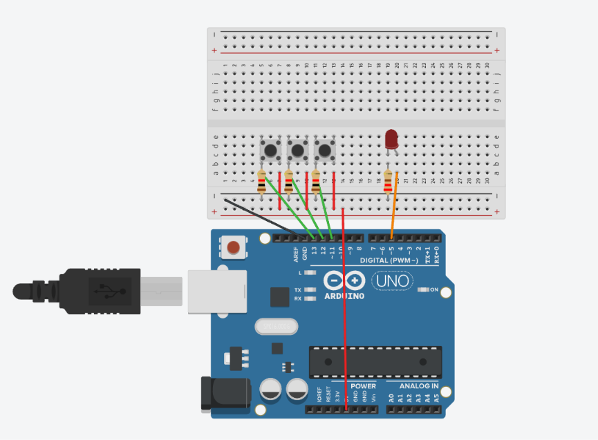

# 📚 Actividad A3.2: Avances de Proyecto 6 — Implementación de Puertas Lógicas (AND, OR, NOT)

> Sexta etapa del proyecto para la materia de Proyectos Intro a la Ingeniería (UDEM), enfocada en la simulación e implementación de lógica booleana mediante selección de modos dinámicos en Arduino.

---

## 1) Resumen

- **Materia:** Proyectos Intro a la Ingeniería
- **Profesor:** Dr. Antonio Martínez Torteya
- **Equipo:** 
  - Juan Carlos Valdés Pérez
  - Antonio Isidoro Ureña Chaidez 
  - Marcelo Cantú Palacios
  - Sofía Posas
- **Fecha:** 05/11/2026
- **Placa:** Arduino Uno R3 (Elegoo)
- **Descripción breve:** Simulación en Arduino de las operaciones lógicas fundamentales (AND, OR y NOT) utilizando tres pulsadores y un indicador LED. Un pulsador actúa como selector de modo de operación con *debouncing* básico, mientras que los dos restantes suministran las entradas booleanas del sistema.

---

## 2) Introducción

El presente reporte documenta la implementación y validación de las compuertas lógicas básicas (AND, OR y NOT) como etapa fundamental del proyecto en la materia de Proyectos Intro a la Ingeniería. Las operaciones booleanas constituyen la base del procesamiento de datos en los sistemas digitales y de control embebido, permitiendo que un microcontrolador tome decisiones complejas en función de múltiples condiciones de entrada.

El objetivo de esta actividad es construir un sistema multifuncional en el cual el usuario interactúe con tres botones: uno dedicado a la selección secuencial del modo de operación (AND $\rightarrow$ OR $\rightarrow$ NOT) y dos destinados a proporcionar los estados lógicos de entrada ($A$ y $B$). La salida evaluada se visualiza en tiempo real mediante un LED y se monitorea dinámicamente mediante el puerto serie de la tarjeta Arduino Uno.

---

## 3) Metodología

### 3.1 Conexiones

**Componentes utilizados y justificación técnica:**

- **1 LED (Diodo Emisor de Luz):** Indicador visual de la salida lógica calculada ($Salida = 1 \implies$ LED Encendido).
- **1 Resistencia de 220 Ω (Limitadora para el LED):** Diseñada para un LED estándar ($V_f \approx 2.0\text{ V}$) alimentado desde la salida digital de 5V del Arduino a una corriente nominal $I_f \approx 13.63\text{ mA}$:
  $$R = \frac{V_{\text{fuente}} - V_f}{I_f} = \frac{5\text{ V} - 2\text{ V}}{0.01363\text{ A}} \approx 220\ \Omega$$
- **3 Pulsadores (*Push Buttons*):** 
  - `PIN_A` (Pin 13): Entrada lógica operand A (Botón Izquierdo).
  - `PIN_B` (Pin 12): Entrada lógica operand B (Botón Central).
  - `PIN_MODO` (Pin 11): Selector de función booleana (Botón Derecho).
- **3 Resistencias de 10 kΩ (Pull-Down externas):** Conectadas entre cada pin de entrada digital (13, 12, 11) y tierra (**GND**). Evitan el estado flotante (alta impedancia) asegurando un nivel bajo ($0\text{ V}$ / `LOW`) cuando los botones no están presionados, garantizando transiciones limpias a $5\text{ V}$ (`HIGH`) al activarse.
- **Protoboard y Jumpers:** Conexión y distribución de señales.

**Descripción de las conexiones digitales:**

- **Salida Digital (`PIN_LED = 5`):** El Pin Digital 5 se conecta al ánodo del LED; el cátodo se conecta a GND mediante el resistor de 220 Ω.
- **Entradas Digitales (`PIN_A = 13`, `PIN_B = 12`, `PIN_MODO = 11`):** Una terminal de cada pulsador se conecta a la línea de **5V**. La terminal opuesta de cada botón se conecta simultáneamente a su respectivo pin digital del Arduino (13, 12 o 11) y a una resistencia de pull-down de 10 kΩ referenciada a **GND**.

**Diagrama de conexiones:**


*(Nota: El archivo de imagen y diagrama esquemático editable se encuentra adjunto en la carpeta `/Recursos/imgs/` del repositorio).*

---

### 3.2 Código

El sketch en C++ implementa una máquina de estados finitos simple y detección de flancos positivos (*rising edge*) para la conmutación de modos de operación.

**Declaración de constantes y variables de control:**
- `PIN_A`, `PIN_B`, `PIN_MODO` y `PIN_LED` establecen la asignación física de pines.
- `modo` (entero): Almacena la función activa (`0 = AND`, `1 = OR`, `2 = NOT`).
- `ultimoEstadoModo` (booleano): Guarda el estado anterior del botón de modo para implementar una detección de cambio de estado (flanco de subida) con *anti-rebote* software de 50 ms.
- `ultimaSalida` (entero): Variable de control para evitar la impresión repetitiva en la consola serial, transmitiendo datos únicamente cuando la función o los valores de entrada cambian.

**Configuración (`setup()`):**
- Configura `PIN_A`, `PIN_B` y `PIN_MODO` como entradas digitales (`INPUT`).
- Configura `PIN_LED` como salida digital (`OUTPUT`).
- Inicializa el puerto serie a 9600 baudios notificando la función inicial ("AND").

**Lógica de ejecución (`loop()`):**
1. **Lectura de entradas:** Evalúa si las entradas están en `HIGH` devolviendo un valor booleano (`true`/`false`).
2. **Conmutación de Modo:** Detecta el flanco donde `botonModo` pasa a ser `true` mientras `ultimoEstadoModo` era `false`. Al cumplirse, incrementa `modo` cíclicamente mediante el operador módulo `(modo + 1) % 3` y aplica un pequeño `delay(50)` para estabilizar la lectura mecánica del botón.
3. **Evaluación Booleana (`switch-case`):**
   - **Caso 0 (AND):** `salida = a && b`. El LED enciende solo si ambos botones (A y B) están presionados.
   - **Caso 1 (OR):** `salida = a || b`. El LED enciende si al menos uno de los botones (A o B) está presionado.
   - **Caso 2 (NOT):** `salida = !a`. Invierte el estado del Botón A (enciende el LED cuando A NO está presionado).
4. **Escritura y Telemetría Serial:** Actualiza el pin del LED con `digitalWrite(PIN_LED, salida)` y calcula una firma de estado `int estado = (modo * 100) + (a * 10) + b`. Si difiere de `ultimaSalida`, imprime la telemetría por el Monitor Serial.

**Código completo:**

```cpp
const int PIN_A = 13;     // botón izquierdo
const int PIN_B = 12;     // botón central
const int PIN_MODO = 11;  // botón derecho
const int PIN_LED = 5;

int modo = 0;                 // 0 = AND, 1 = OR, 2 = NOT
bool ultimoEstadoModo = false;
int ultimaSalida = -1;

void setup() {
  pinMode(PIN_A, INPUT);      // pull-down externo
  pinMode(PIN_B, INPUT);
  pinMode(PIN_MODO, INPUT);
  pinMode(PIN_LED, OUTPUT);
  Serial.begin(9600);
  Serial.println("Funcion actual: AND");
}

void loop() {
  bool a = (digitalRead(PIN_A) == HIGH);      // true si está presionado
  bool b = (digitalRead(PIN_B) == HIGH);
  bool botonModo = (digitalRead(PIN_MODO) == HIGH);

  if (botonModo && !ultimoEstadoModo) {
    modo = (modo + 1) % 3;
    ultimaSalida = -1;
    delay(50);
  }
  ultimoEstadoModo = botonModo;

  bool salida = false;
  const char* nombre;

  switch (modo) {
    case 0: salida = a && b; nombre = "AND"; break;
    case 1: salida = a || b; nombre = "OR";  break;
    case 2: salida = !a;     nombre = "NOT (usa solo boton A)"; break;
  }

  digitalWrite(PIN_LED, salida);

  int estado = (modo * 100) + (a * 10) + b;
  if (estado != ultimaSalida) {
    ultimaSalida = estado;
    Serial.print("Funcion: ");
    Serial.print(nombre);
    Serial.print(" | A=");
    Serial.print(a);
    Serial.print(" B=");
    Serial.print(b);
    Serial.print(" -> LED=");
    Serial.println(salida);
  }
}
```
--- 

## 4) Resultados

A continuación se anexan los elementos de prueba y validación visual del funcionamiento del circuito:

### 4.1 Demostración en Simulación (Digital)
<p align="center">
  
</p>

</p>
> 📹 **Respaldo:** El archivo multimedia se encuentra almacenado en [`Gif_Funcionamiento_Tinkercad.gif`](./Recursos/videos/Gif_Funcionamiento_Tinkercad.gif)

---

### Tabla de Verdad y Validación de Comportamiento

| Modo | Operación | Entrada A | Entrada B | Salida Teórica ($Salida$) | Estado LED |
| :---: | :---: | :---: | :---: | :---: | :---: |
| **0** | **AND** | `LOW` (0) | `LOW` (0) | 0 | Apagado |
| **0** | **AND** | `HIGH` (1) | `HIGH` (1) | 1 | **Encendido** |
| **1** | **OR** | `HIGH` (1) | `LOW` (0) | 1 | **Encendido** |
| **1** | **OR** | `LOW` (0) | `LOW` (0) | 0 | Apagado |
| **2** | **NOT** | `LOW` (0) | N/A | 1 | **Encendido** |
| **2** | **NOT** | `HIGH` (1) | N/A | 0 | Apagado |

- **Conmutación de Operaciones:** El pulso en `PIN_MODO` conmuta de forma fluida la lógica de evaluación booleana, eliminando lecturas eráticas por falso contacto mecánico gracias al filtro de retardo de 50 ms.
- **Monitoreo Serie Eficiente:** El filtro condicional `if (estado != ultimaSalida)` optimizó la transmisión de datos por el Monitor Serial a 9600 baudios, transmitiendo información únicamente ante variaciones en las entradas o cambios en la selección del modo.

---

## 5) Conclusiones

La realización de esta práctica permitió implementar y validar satisfactoriamente la simulación de compuertas lógicas digitales (AND, OR y NOT) sobre la plataforma Arduino Uno R3:

- Se confirmó experimentalmente el comportamiento booleano en hardware y software, verificando que la salida del indicador LED responde fielmente a las tablas de verdad teóricas de cada operación.
- El cálculo e implementación de arreglos de resistencias pull-down externas de 10 kΩ demostró ser indispensable para garantizar niveles lógicos $0\text{ V}$ estables, eliminando por completo el ruido electromagnético y el fenómeno de pin flotante.
- La estructura algorítmica de conmutación de modos basada en detección de flancos y filtrado de telemetría serial aseguró un procesamiento eficiente en el microcontrolador.

Este avance consolida los conceptos fundamentales de lógica digital necesarios para el desarrollo de rutinas de control más complejas en las subsecuentes etapas del proyecto integrador.